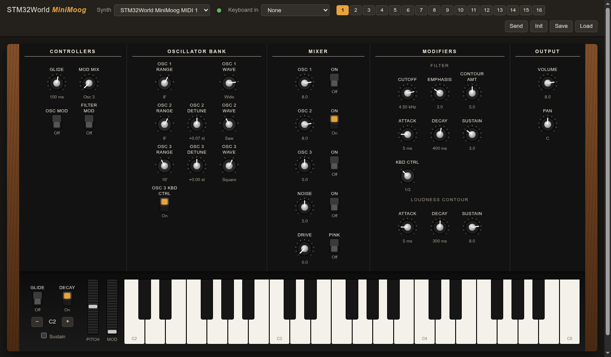

# STM32 Polyphonic MIDI MiniMoog

Polyphonic, multitimbral USB MIDI synthesizer on the STM32F407 replicating
the Minimoog Model D audio chain, with audio out through the PCM5102 audio
DAC Streamline blade.

Wiki: https://stm32world.com/wiki/STM32_Polyphonic_MIDI_MiniMoog

- `synth/` - the synth engine, MIDI CC map and MIDI handling
- `samples/` - short demo recordings from the line out
- `web/` - HTML5 panel and keyboard that talks to the synth over Web MIDI
- `tools/demos.py` - plays the demo sequences (patches as CCs) into the synth over raw MIDI
- `tools/record_demos.sh` - resets the board, plays each demo while recording
  the line input and writes `samples/<demo>.mp3`

Recording the demos (Linux, needs python3, parecord, sox and lame):

    tools/record_demos.sh            # all demos
    tools/record_demos.sh lead       # just one

## Web panel

`web/index.html` is a Minimoog style panel with a keyboard. It talks to the
synth directly with Web MIDI (Chrome, Edge, Opera or Firefox), so no server
software is needed on the synth side. Web MIDI only works on a secure origin,
so serve it locally:

    cd web
    python3 -m http.server 8000

and open http://localhost:8000, allow MIDI access and pick "STM32World
MiniMoog" as the synth (it is selected automatically when found).

- Each of the 16 channel buttons shows that channel's patch; the page keeps all
  16 in the browser's local storage and sends the patch when you switch channel
  or press Send.
- Knobs: drag up/down (shift for fine), mouse wheel or arrow keys, double-click
  for the default.
- Keyboard: mouse/touch or the computer keyboard (Z-M and Q-I rows), octave
  buttons, sustain, pitch bend and mod wheel.
- "Keyboard in" forwards a hardware MIDI keyboard to the selected channel.
- Save/Load store a channel's patch as JSON.
